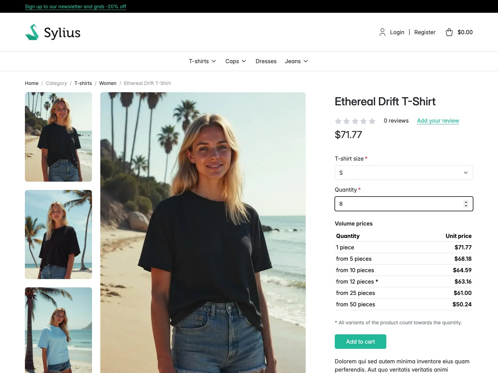
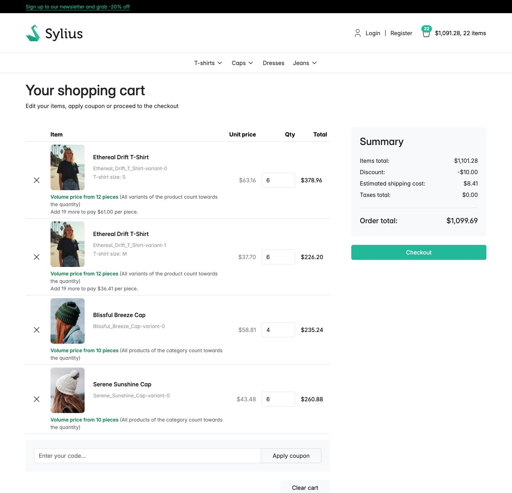
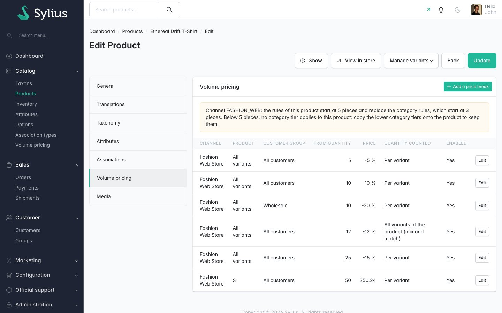
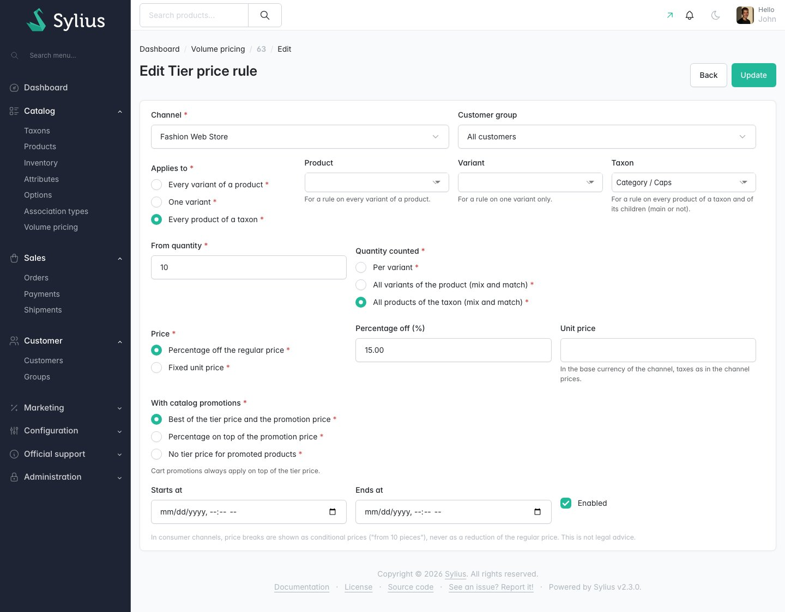

# Sylius Tier Pricing Plugin

> English: [README.md](README.md) <!-- vitrine:lang -->

[](https://github.com/thibmonier/sylius-tier-pricing-plugin/actions/workflows/build.yaml)
[](LICENSE)

**Prix dégressifs (par paliers de quantité) pour Sylius 2 : « dès 10 pièces, 9,00 € la pièce ».**

Sylius 2 propose un seul prix par variante et par canal. Les paliers de prix selon la quantité sont
un besoin de base des boutiques de gros et B2B (et de nombreuses boutiques grand public), mais les
plugins open source qui les géraient ciblent Sylius 1, et les moteurs Sylius Plus / Elesto sont
propriétaires.

Ce plugin ajoute des règles de paliers de prix par canal, groupe de clients, produit ou variante,
les applique dans le panier, et les affiche sur les pages produit et dans le panier sous forme de
prix conditionnels, gratuitement et en open source.

## Fonctionnalités

| Besoin | Ce que fait le plugin |
|---|---|
| Baisser le prix unitaire à partir d'une quantité | **Règles** : à partir de `N` pièces (N >= 2), un **prix unitaire fixe** ou un **pourcentage de remise** sur le prix habituel, par canal, éventuellement pour un **groupe de clients**, avec des dates de début et de fin facultatives. |
| Cibler ce que vous vendez | Une règle s'applique à **une variante**, à **toutes les variantes d'un produit** ou *(1.1)* à **tous les produits d'une taxonomie** et de ses enfants (via n'importe quelle taxonomie du produit, pas seulement la principale). Le seuil compte la ligne du panier, **toutes les variantes du produit** (panachage : 6 rouges + 4 bleues = 10) ou *(1.1)* **tous les produits de la taxonomie** (4 perceuses + 6 scies = 10 outils). |
| Priorité claire *(1.1)* | Les règles de variante et de produit d'abord, sinon celles de la **taxonomie la plus profonde** du produit, sinon le prix habituel. |
| Résultats prévisibles | Le niveau le plus spécifique qui a des règles pour le client l'emporte (variante/produit, sinon la taxonomie la plus profonde, voir [Comment les prix sont calculés](#comment-les-prix-sont-calculés)) ; à l'intérieur de ce niveau, le **prix unitaire le plus bas** parmi les règles atteintes l'emporte (la spécificité ne sert qu'à départager les égalités). Le prix n'augmente jamais avec la quantité, et le tableau du produit montre ce que le panier facture pour la ligne (les paliers sur base taxonomie comptent aussi les autres produits de la taxonomie présents dans le panier). |
| Paniers corrects | Un processeur de commande (priorité 44) modifie le prix unitaire de la ligne du panier ; les promotions de panier, la livraison et les taxes sont calculées dessus. Les lignes verrouillées (immuables), par exemple les lignes de devis négociées, ne sont pas touchées. |
| Pas de double remise, ou une remise choisie | Par règle *(1.1)* : **le meilleur des deux** entre le prix palier et le prix de promotion catalogue (par défaut, comportement 1.0 ; un pourcentage est calculé sur le prix habituel), **en plus** (le pourcentage est retiré du prix promotionnel) ou **ignorer si en promotion** (pas de prix palier pour une variante en promotion catalogue). Le prix minimum de la tarification du canal sert de plancher ; les promotions de panier s'appliquent toujours en plus du prix palier. |
| Afficher les prix | **Tableau des paliers** sur la page produit (recalculé quand la variante change), messages incitatifs **« ajoutez-en 3 pour payer 8,00 € la pièce »** sur la page produit et dans le panier, « prix dégressif dès 10 pièces » sur les lignes du panier. |
| Rester du bon côté des règles sur les prix | Les paliers sont affichés comme des prix conditionnels : pas de prix barré (y compris dans l'API boutique : dans les canaux grand public, `originalUnitPrice` d'une ligne à palier est le prix palier et son ajustement `tmonier_tier_price` a un montant nul), pas de « -x % » dans les canaux grand public par défaut, montants dans la convention de taxes des prix Sylius qui les accompagnent, avec une mention (voir [Mentions légales](#mentions-légales)). |
| Gérer les règles | Grille d'administration (*Catalogue > Prix dégressifs*), formulaire de règle, **onglet Prix dégressifs** sur la page produit. |
| Modifications en masse | `tmonier:tier-pricing:import` / `:export` (CSV, upsert ou remplacement, simulation, tout ou rien). |
| Headless | CRUD de l'API d'administration `/api/v2/admin/tier-price-rules`, API boutique `GET /api/v2/shop/product-variants/{code}/tier-prices`. |

Également inclus : traductions en anglais, français, allemand, espagnol, italien, néerlandais et
polonais ; Twig Hooks partout ; cache à tags par produit, canal et groupe de clients ; fixture de
démonstration ; prise en charge de MySQL, MariaDB et PostgreSQL.

## Captures d'écran









## Prérequis

| | Version |
|---|---|
| PHP | 8.2+ (Sylius 2.2), 8.3+ (Sylius 2.3) |
| Sylius | 2.2.9+, 2.3 |
| Symfony | 6.4, 7.4 (Sylius 2.2) ; 6.4, 7.4, 8.0 (Sylius 2.3, Symfony 8 exige PHP 8.4) |

Sylius 2.2.9 est la version minimale car le plugin modifie les prix du panier : les versions 2.2
antérieures sont concernées par GHSA-2rv4-pjmm-7fxf et GHSA-vv4h-q2x8-74g4 (demandes de paiement).

## Installation

1. Ajoutez le paquet :

    ```bash
    composer require tmonier/sylius-tier-pricing-plugin
    ```

2. Enregistrez le bundle dans `config/bundles.php` (Symfony Flex le fait automatiquement dès qu'une recette existe) :

    ```php
    Tmonier\SyliusTierPricingPlugin\TmonierSyliusTierPricingPlugin::class => ['all' => true],
    ```

3. Importez la configuration dans `config/packages/tmonier_sylius_tier_pricing.yaml` :

    ```yaml
    imports:
        - { resource: "@TmonierSyliusTierPricingPlugin/config/config.yaml" }
    ```

4. Importez les routes d'administration dans `config/routes/tmonier_sylius_tier_pricing.yaml` :

    ```yaml
    tmonier_sylius_tier_pricing:
        resource: "@TmonierSyliusTierPricingPlugin/config/routes.yaml"
    ```

    Les opérations d'API sont enregistrées automatiquement auprès de l'API Sylius (`/api/v2`).

5. Lancez les migrations (une table et une contrainte CHECK) :

    ```bash
    bin/console doctrine:migrations:migrate
    ```

## Configuration

```yaml
# config/packages/tmonier_sylius_tier_pricing.yaml
tmonier_sylius_tier_pricing:
    b2b_channels: []        # business channel codes (only changes the defaults below)
    percentage_column:      # "-x %" column of the tier table
        b2c: false
        b2b: true
    product_page: true      # tier table and nudge on product pages
    cart: true              # tier applied and next tier in the cart
    group_prices_for_guests: false  # customer group rules for guest checkouts too (see below)
    cache_ttl: 3600         # cached rules per product (0 = no cache); saving a rule invalidates them
```

**Règles par groupe de clients.** Dans les requêtes de la boutique (pages de la boutique et API
boutique), les règles de groupe ne s'appliquent que si le client de la commande est le client
connecté. Lors d'un tunnel de commande en invité, Sylius rattache à la commande un client existant
(sans compte boutique, fréquent pour les clients B2B créés dans l'administration) à partir de
l'e-mail saisi par le visiteur : quiconque connaîtrait cet e-mail obtiendrait les prix du groupe.
Partout ailleurs (administration, API d'administration, console, consommateurs de messages :
commandes créées pour le compte d'un client, conversions de devis, imports), le groupe du client de
la commande s'applique. Définissez `group_prices_for_guests: true` pour appliquer aussi les règles de
groupe dans les requêtes de la boutique.

**Taxes.** Sylius n'a pas de réglage « prix avec / sans taxes » par canal : le prix d'un canal inclut
la taxe ou non selon le taux de taxe (`includedInPrice`) de la variante. Les montants des paliers
sont affichés tels qu'enregistrés, dans la même convention que le prix produit et le prix unitaire du
panier Sylius qui les accompagnent, avec une mention « TTC / HT » tirée du taux de la variante dans la
zone de taxation par défaut du canal (pas de mention quand elle est inconnue : pas de zone de
taxation par défaut, pas de taux). Les canaux grand public de l'UE devraient enregistrer des prix
taxes comprises (taux `includedInPrice`).

Les règles d'un produit sont mises en cache dans le pool `cache.tmonier_tier_pricing` (tags : produit,
canal, groupe de clients ; adaptateur `cache.app` par défaut). Toute règle enregistrée via Doctrine
(administration, API, import) invalide son produit **dans ce pool**. Avec plusieurs nœuds web ou
workers, `cache.app` doit être partagé (par exemple Redis), ou bien configurez le pool sur un
adaptateur partagé compatible avec les tags, ou définissez `cache_ttl: 0` : avec un cache local sur
système de fichiers, les autres nœuds gardent les anciennes règles jusqu'à l'expiration de
`cache_ttl`.

```yaml
framework:
    cache:
        pools:
            cache.tmonier_tier_pricing:
                adapter: cache.adapter.redis_tag_aware
                provider: '%env(REDIS_URL)%'
```

### Règles

| Champ | Valeurs |
|---|---|
| Canal | obligatoire ; les montants sont dans sa devise de base |
| Groupe de clients | vide = tout le monde |
| S'applique à | `product` (toutes les variantes), `variant` ou `taxon` (tous les produits de la taxonomie et de ses enfants, 1.1) |
| Quantité comptée | `line` (la variante), `product` (toutes les variantes du produit, panachage) ou `taxon` (tous les produits de la taxonomie de la règle, règles de taxonomie uniquement, 1.1) |
| Avec les promotions catalogue (1.1) | `best_of` (par défaut), `on_top` ou `skip_if_promoted` |
| À partir de la quantité | 2 à 1 000 000 |
| Prix | `percentage_off` (du prix habituel, avant promotions catalogue) ou `fixed_unit_price` (même convention de taxes que les prix du canal, au plus 10 000 000,00) |
| Activée, début, fin | la fin est exclue ; les dates sont enregistrées dans le fuseau horaire PHP par défaut (UTC recommandé, comme pour Sylius), une date donnée avec un autre décalage conserve son instant |

Une règle par canal, groupe de clients, cible et seuil sur une période : contrôlé par l'application
(un index unique traiterait les règles « tout le monde » comme distinctes sur MySQL, MariaDB et
PostgreSQL < 15).

### Import et export CSV

```bash
bin/console tmonier:tier-pricing:export rules.csv [--channel=FASHION_WEB]
bin/console tmonier:tier-pricing:import rules.csv --dry-run
bin/console tmonier:tier-pricing:import rules.csv [--mode=upsert|replace] [--channel=FASHION_WEB]
```

```csv
channel,customer_group,scope,product,variant,quantity_basis,min_quantity,type,value,enabled,starts_at,ends_at,taxon,cumulation
FASHION_WEB,,product,Everyday_white_basic_T_Shirt,,line,10,percentage_off,7.5,1,,,,best_of
FASHION_WEB,wholesale,variant,,Everyday_white_basic_T_Shirt-variant-0,line,50,fixed_unit_price,6.40,1,2027-01-01T00:00:00+00:00,,,
FASHION_WEB,,taxon,,,taxon,20,percentage_off,5,1,,,t_shirts,on_top
```

Les deux dernières colonnes sont nouvelles en 1.1 (`taxon` : code de la taxonomie d'une règle de
taxonomie ; `cumulation` : vide = `best_of`) ; les fichiers aux 12 colonnes de la 1.0 sont toujours
importés.

`value` est un montant (`6.40`) pour un prix fixe et un pourcentage (`7.5`) pour une remise en
pourcentage. `enabled` vaut `1`, `true`, `yes`, `0`, `false`, `no` ou vide (activée) ; toute autre
valeur est une erreur. Les dates sont au format ISO 8601 ; leur décalage est conservé (converti dans
le fuseau horaire de l'application). Un éventuel indicateur d'ordre des octets UTF-8 en tête de
fichier (« CSV UTF-8 » d'Excel) est ignoré. Deux lignes pour la même règle sont signalées
(`duplicate of line N`).
`upsert` met à jour la règle ayant les mêmes canal, groupe, cible, seuil et dates, ou la crée ;
`replace` supprime d'abord toutes les règles (de `--channel`). Le fichier entier s'exécute dans une
seule transaction : une ligne invalide et rien n'est enregistré (toutes les erreurs sont listées avec
leur numéro de ligne). L'entity manager est vidé toutes les 500 lignes.

### Point d'extension

Implémentez `Tmonier\SyliusTierPricingPlugin\OrderProcessing\TierPriceExemptionCheckerInterface`
(autoconfiguré) pour garder certaines lignes du panier hors de la tarification par paliers (elles
conservent leur prix et ne comptent pas dans la quantité de leur produit).

## Personnalisation

| Hook | Contenu |
|---|---|
| `sylius_shop.product.show.content.info.summary.add_to_cart` → `tmonier_tier_pricing` | Tableau des paliers et message incitatif (entre la quantité et le bouton) |
| `sylius_shop.cart.index.content.form.sections.general.items.body` → `item` | Cellule produit du cœur + palier appliqué + message incitatif sous le produit (remplace le modèle du cœur) |
| `sylius_admin.product.update.content.form.side_navigation` / `.sections` → `tmonier_tier_pricing` | Onglet Prix dégressifs du formulaire produit |
| `tmonier_tier_pricing_admin.tier_price_rule.create\|update.content.form.sections.general` → `fields` | Mise en page du formulaire de règle |

Les modèles peuvent être remplacés dans `templates/bundles/TmonierSyliusTierPricingPlugin/`. Fonctions
Twig : `tmonier_tier_pricing_table(variant)`, `tmonier_tier_pricing_cart_table(item)`,
`tmonier_tier_pricing_tax_convention(variant)`, `tmonier_tier_pricing_item_tier(item)`.
En PHP, `TierPriceCalculatorInterface::quote()` / `table()` donnent le prix palier d'une variante
pour des quantités données.

## Comment les prix sont calculés

- `OrderPricesRecalculator` (priorité 50) remet le prix unitaire de chaque ligne modifiable au prix
  catalogue ; le verrouillage de prix du devis de
  [tmonier/sylius-quote-request-plugin](https://github.com/thibmonier/sylius-quote-request-plugin)
  s'exécute à 45 ; le processeur de paliers à **44** ; puis la livraison (40, 30), les promotions
  (20), les taxes (10).
- Pour chaque ligne modifiable et non exemptée : les règles du produit (et, en 1.1, des taxonomies du
  produit et de leurs ancêtres) pour le canal et le groupe de clients de la commande (dans les
  requêtes de la boutique, uniquement pour le client connecté par défaut).
- **Priorité (1.1)** : les règles de variante et de produit ; si aucune ne cible la variante, le client
  et la date du jour, les règles de la taxonomie la plus profonde qui a de telles règles (plusieurs
  taxonomies à cette profondeur sont en concurrence) ; sinon aucune. Un niveau est choisi quelle que
  soit la quantité, donc une règle de produit à partir de 20 pièces masque une règle de taxonomie à
  partir de 5 pièces : en dessous de 20 pièces, il n'y a pas de prix palier (le prix n'augmente jamais
  avec la quantité). L'administration le signale sur la page produit (onglet Prix dégressifs) et sur
  le formulaire de règle.
  **Astuce** : pour conserver les paliers de catégorie sous ceux du produit, recopiez-les sur le
  produit (par exemple catégorie dès 10 : -5 %, produit dès 50 : -10 % : ajoutez une règle de produit
  dès 10 : -5 %), ou ne mettez aucune règle sur le produit et laissez la catégorie s'appliquer.
- Dans ce niveau, les règles applicables à la quantité de la ligne, du produit ou de la taxonomie
  (lignes modifiables et non exemptées uniquement ; les règles `skip_if_promoted` sont écartées pour
  une variante en promotion catalogue) donnent chacune un prix : prix fixe, ou prix habituel
  (`on_top` : prix courant) moins le pourcentage, arrondi à la demi-unité supérieure, au moins le prix
  minimum de la tarification du canal, au plus le prix courant. Le prix **le plus bas** l'emporte ; en
  cas d'égalité, la règle la plus spécifique (variante, puis groupe de clients, puis seuil le plus
  élevé), puis la plus ancienne.
  Le tableau du produit est calculé avec la même fonction pour chaque seuil.
- Dans les canaux grand public, le prix unitaire d'origine d'une ligne à palier est fixé au prix
  palier, afin que ni le panier ni un front headless utilisant l'API boutique
  (`originalUnitPrice > unitPrice`) n'affiche le prix habituel barré. Les canaux professionnels y
  conservent le prix habituel.
- La ligne reçoit un ajustement **neutre** `tmonier_tier_price` (sans effet sur les totaux) avec
  l'identifiant de la règle, le seuil et le prix sans palier dans ses détails : la commande garde une
  trace du palier appliqué. Son montant est la différence avec le prix sans palier dans les canaux
  professionnels, **0 dans les canaux grand public** (1.1) : les points d'entrée d'ajustements de
  l'API boutique (`/orders/{token}/adjustments`, `/orders/{token}/items/{id}/adjustments`)
  permettraient sinon à un front headless de l'afficher comme une réduction sur le prix habituel. Les
  détails ne sont pas exposés par l'API boutique.
- `ChannelPricing` n'est jamais modifié : l'historique des prix utilisé pour le « prix le plus bas
  avant la réduction » reste celui du catalogue.
- Conséquence : les règles de promotion de panier sur le total des articles et les seuils de
  livraison gratuite voient les prix paliers.

## Mentions légales

*Ceci n'est pas un conseil juridique ; consultez votre conseil, en particulier pour les canaux grand
public (B2C) de l'UE.*

- Depuis l'arrêt CJUE C-330/23 (Aldi Süd, 26 septembre 2024) et l'art. 6 bis de la directive
  98/6/CE sur l'indication des prix (directive Omnibus 2019/2161), une **réduction de prix** annoncée
  doit être calculée à partir du prix le plus bas des 30 derniers jours. Un palier de quantité est un
  **prix conditionnel** (« 9,00 € dès 10 pièces »), pas une réduction du prix : le plugin l'affiche
  ainsi, ne barre pas le prix habituel pour un palier (pages de la boutique et API boutique), et
  masque par défaut la colonne « -x % » dans les canaux grand public (elle compare avec le prix d'une
  pièce, pas avec un prix antérieur).
- Les réductions que le plugin ne crée pas conservent l'**affichage du cœur de Sylius**, que ce
  plugin ne modifie pas : pendant une promotion catalogue (ou avec un prix « barré » manuel), la page
  produit et le panier barrent `ChannelPricing.originalPrice`, et la page produit affiche le prix le
  plus bas des 30 derniers jours sur une ligne séparée. Les **fiches produit** (listes de produits,
  pages de taxonomie, page d'accueil, produits associés / liés) barrent `originalPrice` **sans** la
  ligne du prix le plus bas. Pour la conformité B2C, gardez
  `originalPrice` égal au prix le plus bas des 30 derniers jours, ou remplacez ces modèles du cœur.
  Quand un prix palier l'emporte sur une promotion catalogue, aucun prix barré n'est affiché.
- Les prix grand public doivent inclure les taxes : enregistrez les prix des canaux grand public taxes
  comprises (taux de taxe `includedInPrice`). Les montants des paliers suivent la convention des prix
  du canal et sont accompagnés de la mention correspondante ; aucune mention « taxes comprises »
  n'est affichée quand la convention ne peut pas être déterminée.

## Limitations

- Pas de formulaire d'envoi de CSV dans l'administration ; pas de badge ni de « dès X » sur les
  listes de produits (prévu pour la 1.2).
- `skip_if_promoted` ne regarde que les promotions catalogue : les promotions de panier sont calculées
  après le prix palier (priorité 20 < 44) et s'appliquent toujours en plus.
- `on_top` avec un prix unitaire fixe se comporte comme `best_of` (le meilleur des deux entre le prix
  fixe et le prix promotionnel).
- Sur la page produit, un seuil sur base taxonomie compte les lignes de la taxonomie déjà présentes
  dans le panier ; le message incitatif ne sait pas quels autres produits le client va ajouter.
- Le message incitatif de la page produit est calculé à partir du contenu du panier, pas de la
  quantité saisie dans le formulaire d'ajout au panier (le composant Sylius n'est pas réaffiché
  quand la quantité change).
- Un pourcentage s'applique à `originalPrice` quand une promotion catalogue est appliquée ; si le
  marchand utilise aussi `originalPrice` comme prix « barré » manuel, la base du pourcentage est ce
  prix (la règle du meilleur des deux plafonne quand même le résultat au prix promotionnel).
- La mention de taxes utilise la zone de taxation par défaut du canal, pas l'adresse du client.
- La grille d'administration charge les noms de produits une fois par produit (les traductions ne
  sont pas jointes).
- Les prix paliers dans les listes de prix de Sylius Plus et dans l'Elesto Advanced Pricing Engine ne
  sont ni pris en charge ni testés.

## Développement

```bash
docker compose up -d mysql mailhog   # empty root password; host ports in compose.override.yml
composer install
(cd vendor/sylius/test-application && yarn install && yarn build)
vendor/bin/console doctrine:database:create
vendor/bin/console doctrine:migrations:migrate -n
vendor/bin/console sylius:fixtures:load -n     # includes demo tier rules
```

Les tests fonctionnels et d'intégration ont besoin d'une **base de données de test avec les fixtures
Sylius** (administrateur `sylius`, `shop@example.com`, un canal avec le nom d'hôte `localhost` et une
zone de taxation par défaut). `tests/TestApplication/.env.test` utilise les identifiants de la CI
(`root:root`) ; avec le MySQL Docker local, remplacez-les dans `tests/TestApplication/.env.test.local` :

```bash
echo 'DATABASE_URL=mysql://root@127.0.0.1:3306/tmonier_sylius_tier_pricing_%kernel.environment%' > tests/TestApplication/.env.test.local
APP_ENV=test vendor/bin/console doctrine:database:create
APP_ENV=test vendor/bin/console doctrine:migrations:migrate -n
APP_ENV=test vendor/bin/console sylius:fixtures:load -n

vendor/bin/phpunit --testsuite unit
APP_ENV=test vendor/bin/phpunit --testsuite non-unit
vendor/bin/phpstan analyse
vendor/bin/ecs check
```

<!-- vitrine:demo-b2b:start -->
## Démo B2B

Ce plugin est utilisé dans la [démo B2B Sylius](https://github.com/thibmonier/sylius-b2b-demo) : une boutique Sylius 2.3 avec des données d'exemple fictives, où les plugins B2B fonctionnent ensemble. Le code source, l'installation et les fixtures de la démo sont dans ce dépôt.

La démo est un exemple, pas une configuration de production.
<!-- vitrine:demo-b2b:end -->

## Licence

MIT. Voir [LICENSE](LICENSE).
